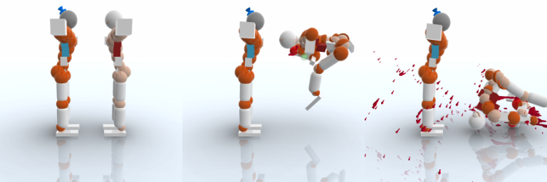

# envs

ToriLLE comes with OpenAI Gym environment and several pre-defined tasks, which can be used
as a (almost) drop-in replacements to e.g. Atari environments.

Register these environments by importing `torille.envs`.

Limitations:
* `render()` function is not implemented (only one type of state available)

## Observation type

By default every environment returns its own flat `Box` observation, described per
environment below. Pass `observation_type="dict"` to get a structured `Dict` observation
instead; the action space and rewards do not change. Every environment id accepts the flag:

```python
env = gym.make("Toribash-DestroyUke-v2", observation_type="dict")
```

The `Dict` observation is the same for all environments and describes both players
(index 0 is player 1, index 1 is player 2), all float32. Defined in
`torille.envs.observations`:

Key | Shape | Bounds | Meaning
--- | ----- | ------ | -------
`positions` | (2, 21, 3) | +-inf | Limb positions of both players, centred on player 1's groin and rotated by its groin rotation (same frame as the flat Uke/Duo observation)
`groin_height` | (2,) | +-inf | Absolute `z` of each groin (centred positions lose the height above the floor)
`velocities` | (2, 21, 3) | +-inf | Limb velocities, world frame
`joint_states` | (2, 20) | [0, 4] | Joint states: 1 extend, 2 contract, 3 hold, 4 relax
`grips` | (2, 2) | [0, 1] | Left and right hand grip
`match_frame` | (1,) | [0, `matchframes`] | Frames played so far
`frames_next_turn` | (1,) | [0, `matchframes`] | Frames the next turn lasts

Note that `match_frame` advances by `turnframes + 1` per turn in the native game (for
example 0, 6, 12 with `turnframes=5`).

## RGB capture (optional)

The game has no pixel API, so ToriLLE can read the frame of the game window from the X server at each turn
boundary. It is off by default and costs nothing when off. Linux/X11 only, implemented in `torille.capture`
(no dependency beyond `numpy`; Xlib is called through `ctypes`).

```python
env = gym.make(
    "Toribash-DestroyUke-v2", observation_type="dict", capture_size=224, draw_game=True
)
obs, _ = env.reset()
obs["rgb"]  # (224, 224, 3) uint8, the picture of the state in the other keys

env = gym.make("Toribash-DestroyUke-v2", render_mode="rgb_array", draw_game=True)
env.reset()
env.render()  # (256, 256, 3) uint8 of the latest state

env = TwoPlayerToriEnv(
    capture_size=256, draw_game=True
)  # every agent's observation gets "rgb"
```

Constructor options of the Gym environments and of `TwoPlayerToriEnv` (also on `ToribashControl`):

* `draw_game=False`: now an explicit option (before it was only `set_draw_game`). **Capture requires `draw_game=True`**;
  `reset()` raises a `ValueError` otherwise.
* `capture_size=None`: side of the square frame (16..1024). With `observation_type="dict"` it adds the key `rgb`
  (`Box(0, 255, (size, size, 3), uint8)`) to the observation space; with the default `box` observation it is an error
  (use `render_mode`).
* `render_mode=None | "rgb_array"`: `render()` returns a copy of the latest frame (256 px if `capture_size` is not set,
  `None` when no render mode is set, as in Gymnasium). The frame is grabbed once per state and shared by the observation and
  `render()`.
* `capture_crop="center" | "letterbox"`: `center` (default) cuts the largest centred square out of the window
  (a 2560x1440 window loses 560 px on each side), so there are no bars; `letterbox` scales the whole window to fit and
  pads with black, so nothing is cut off and the aspect ratio is kept. Both resize with a box filter.
* `capture_display=None`: X display of the game, default `$DISPLAY`. The window is found on that display (WM class
  `toribash_steam`) and its geometry is read from it, nothing is hard-coded to `:0`.

In `TwoPlayerToriEnv` both agents get the same `rgb` (one camera).

How it works and what was measured (2026-10-27, Steam build 20840792, 2560x1440 window on `:0`, GNOME/mutter, NVIDIA):

* **Alignment.** The game waits for the action between turns, so a grab after `get_state()` shows that state. It is not
  instant: the new picture appears up to about 15 ms after the state arrives after a turn and about 25 ms after a reset. `ToribashControl`
  waits `capture_settle = 0.03` s (`capture_reset_settle = 0.1` s after a reset) from the arrival of the state, which
  was never too early in 40 turns (the frame equals a grab taken 0.4 s later) and costs nothing if your code
  already spent that time. The first frame of a launch is grabbed after the game has drawn something and 0.3 s more.
  `tests/test_native_capture.py` checks that the frame of a turn equals a second grab at the same boundary
  (mean absolute difference below 0.2 of 255), that frames change between turns, are not a single colour, and that
  the first frame of two episodes from the same start pose is the same picture.
* **Camera.** In capture mode the controller script fixes a side view every frame: free camera, angle 0 (camera on the +x side),
  looking at `(1, -0.1, 1.0)` from `(5.5, -0.1, 1.8)` (see `remotecontrol_native.lua`). The fighters start on a line along y around
  x = 1, so they appear side by side. Facts found on the way: the game re-aims its camera while it plays and moves
  the look-at point whenever `set_camera_pos` is called after another angle, so the camera is put back before every drawn frame, and in
  free mode the view direction follows `set_camera_angle`, not the look-at point, so the angle has to match the position.
  The framing is for the default engagement; a larger `engagement_distance` or `random_uke` poses may leave the picture,
  and the camera does not follow the fighters. Keyboard and mouse camera control are disabled.
* **What is switched off.** The HUD (`set_option("hud", 0)`), the ghost (a looping preview of the planned moves) and `jointflash`
  (the glow that fades in on the joints for about 0.7 s after each turn, which made the picture of one state change for a second).
  `jointflash` is a saved game option; ToriLLE kills the game, which does not write its config, and as a safety belt it puts the
  original value back into `custom.cfg`/`temp.cfg` in `~/.local/share/Toribash/` at cleanup.
* **Window and size.** The window is not moved or resized; whatever size it has is captured, cropped and resized to `capture_size`.
  Cost grows with window pixels, a smaller game window (for example 1280x720 in the game's settings) is cheaper.
  Changing the game's resolution from the script was not done because it needs a graphics reload and is saved in the user's settings.
* **Method.** `XShmGetImage` on the game window (shared memory, falls back to `XGetImage`), not on the screen. With the compositing window manager used
  here, the picture of the window is returned even when the screen is locked (the first test happened to run with the lock screen up and
  the frames were still the game). This was observed once on this machine; see the limitations below.

Cost per turn, measured with `scripts/capture_benchmark.py` (`Toribash-DestroyUke-v2`, random actions, `turnframes=5`,
`draw_game=True`, machine mostly idle):

| Stage | Time |
|---|---|
| `XShmGetImage` of the 1440x1440 centre square | 12 ms (median) |
| box resize 1440 to 256 px (numpy, 4 threads) | 7 ms |
| `grab_frame()` in total | 19 ms |
| same square with a new `ffmpeg -f x11grab` process per turn | 105 ms |
| settle wait after the state | 30 ms (turn), 100 ms (reset) |

| Mode | turns/s |
|---|---|
| capture off | 10.3 |
| `rgb` observation (256 px) | 6.2 |
| `render()` after each step (256 px) | 6.1 |

So capture costs about 65 ms per turn here (19 ms grab, 30 ms settle, the rest is the game: the camera is set before each frame and the Lua
`spin_ms` pick-up is unchanged). Timings are very sensitive to other load: with other jobs running, the grab alone took 100-250 ms (the
readback from the GPU is the slow part). A persistent `ffmpeg` pipe reads a frame in about 2 ms, but the frame is whatever the stream has buffered,
so it cannot be tied to a state; per-turn grabbing was chosen because the game is paused anyway.



Frames 0, 10 and 30 of `Toribash-DestroyUke-v0` (seeded random actions, 256 px centre crop, made by `scripts/capture_examples.py`):
the fixed side view at the start pose (fighters side by side, the front fighter hides the back one), a fighter thrown to the right, and
blood and a collapsed fighter after 30 turns.

Limitations (read before collecting data):

* The window must be on the display and mapped. A single-colour frame (black window, minimised game) raises a `RuntimeWarning` once
  per run of such frames; it is a cheap check, not a guarantee. A window overlapped by another window, a moved window, a screen saver or a
  locked screen can change what is returned depending on the window manager and driver (with a compositor
  the window's own pixels were returned in the one lock-screen case seen, with a non-compositing manager other windows would appear in the frame).
  Do not use the desktop for other things during collection, and look at some frames.
* Only the one Toribash window is captured, the desktop is read-only for ToriLLE; no other window or the Steam client is touched.
* The frame is the 3D view only (HUD off). The terminal state of an episode is captured as the game shows it, which may be the end-of-match view.
* One game instance per display (use `InstancePool` for several); the capture path needs a display (`DISPLAY`, `capture_display` or the `display` of direct mode).

## Parallel instances (opt-in direct launch)

By default the game is started through the Steam client (`steam -applaunch`), which gives exactly one game per
machine. Linux only, you can instead start the game executable yourself, from your own copy of the game
directory. This is off by default; the default behaviour is unchanged. The Steam client must be running and logged in
(the game only uses it for Steamworks IPC; without it the game exits with `SteamAPI_Init failed` and ToriLLE says so).

Options of the Gym environments, `TwoPlayerToriEnv` and `ToribashControl`:

* `launch_mode="steam"` (default) or `"direct"`. Direct mode runs `cd <game_dir> && DISPLAY=<display> SteamAppId=248570
  SteamGameId=248570 ./toribash_steam` in its own process group; `close()` (and the exit handler, and a failed launch)
  terminates that group (SIGTERM, SIGKILL after 3 s) and removes `.torille/`, the controller script and the `profile.tbs` entry.
* `game_dir=None`: directory of the game copy, same as `executable=<game_dir>/toribash_steam`. The launch lock
  (`.launchlock`), the bridge (`.torille/`) and the "already running" check are per directory, so copies do not wait for each other.
* `display=None`: direct mode only, the X display to start the game on (default `$DISPLAY`). `capture_display` defaults
  to it, so each instance on its own display is captured unambiguously.

`torille.pool.InstancePool` makes the copies and one Xvfb (1280x720x24, software GL) per instance:

```python
from torille.envs import TwoPlayerToriEnv
from torille.pool import InstancePool

with InstancePool(4) as pool:  # copies under ~/.cache/torille/instances, 4 Xvfb
    envs = [TwoPlayerToriEnv(draw_game=True, capture_size=128, **kw) for kw in pool]
    # one worker (thread or process) per env, each calls reset()/step() on its own env
    for env in envs:
        env.close()
# games, Xvfb processes and copies are gone here (also at interpreter exit)
```

`InstancePool` uses Xvfb by default (`display="xvfb"`), so no game window appears on your desktop; run such scripts with `DISPLAY`
unset (`env -u DISPLAY python script.py`) to make sure nothing can fall back to it.

`for kw in pool` yields `dict(launch_mode="direct", game_dir=..., display=":NNN", capture_display=":NNN")`; it also works
with `gym.make("Toribash-DestroyUke-v2", **kw)`. `InstancePool(n, base_dir=None, display="xvfb", source=None)`:
`display=":0"` puts all instances on an existing display instead (windows appear on that desktop and, with n > 1, capture
cannot tell the windows apart, so it warns). The game must not be running in the copies when the pool closes; if it is, the
pool terminates processes started from its own copies. `pool.disk_bytes` is the disk the copies use, `pool.copy_method` is
`"copy"` or `"reflink"`. `remove_stale_pools()` deletes pool directories left behind by a Python process that was killed
(only directories with a pool marker whose owner PID is gone); it is never called automatically.

Notes:

* One copy is about 0.6 GB (597 MB of files in the install tested). The pool refuses to start if free disk space is below 3 times the
  size of all copies. Copies are plain copies (reflinks, if the filesystem supports them, are tried first and are safe because
  they are copy-on-write). Hardlinks are not used: it was not shown that the game never rewrites those files in place.
* The game's user config (`~/.local/share/Toribash/`) is shared by all instances. In capture mode the saved `jointflash`
  option is changed by the controller script; direct instances take a reference-counted snapshot (state in
  `~/.cache/torille/options.json`), the first one saves the original and the last one restores it. A crashed run is repaired by the next one.
  A Steam-launched game running at the same time uses the old snapshot and is not part of that counting.
* Cleanup runs on `close()`, from `atexit` and on a failed launch. It cannot run if Python is killed with SIGKILL: games and Xvfb
  processes are then left running (their PIDs are not recorded anywhere; stop them yourself).
* Measured speed, requirements and what was not tested: see [parallelism.md](parallelism.md).

## Seeding and determinism

`reset(seed=...)` and `seed(...)` follow the Gymnasium convention and seed `env.np_random`.
That generator is the only source of randomness in ToriLLE: it draws the random opponent's
actions in `Toribash-DestroyUke-v2`. (Before, that opponent used Python's global `random`,
which could not be seeded through the environment.) Seed on the first `reset()`.

Toribash itself has no seed. What was measured (native game, Toribash build 20840792,
`Toribash-DestroyUke-v0`, random actions fixed beforehand, `matchframes` 200, 40 turns):

* The initial state after `reset()` is identical every time (bitwise). The classic mod has
  no random starting pose.
* Replaying the same action sequence gave bitwise identical observations and rewards,
  across episodes in one process, across separate processes, and with `draw_game` on or off.
  Measured divergence: 0.0.
* Hence an episode is a deterministic function of the settings and the actions, and with
  `np_random` seeded the whole of `Toribash-DestroyUke-v2` is reproducible too.

Limits of this claim: it covers only the settings and mod tested (classic, default
physics, two or three action sequences), one machine and one game build. It does not cover
other mods, replays, or a different game version or hardware (floating point results could
differ). `reset()` is only allowed after an episode ended (terminated or truncated).
The tests are in `tests/test_native_integration.py` (`pytest -m native`).

Additional functions/modifications for all environments:
* `set_draw_game(draw)`: Enables/Disables rendering of the game according to boolean parameter. Must be called before the first `reset()` (or pass `draw_game=True` to the constructor).
* `settings` variable: This is a `ToribashSettings` object used to set Toribash's settings on each reset.

`step()` follows the Gymnasium API and returns `(observation, reward, terminated, truncated, info)`:
* `truncated` is `True` when the game ended by reaching `matchframes`. `terminated` is `True` when it ended any other way.
* `info` contains `winner` (`0` tie, `1`/`2` player; `None` unless the game ended), `injuries` (array of both players' injuries) and `match_frame`.

## Two-player API `torille.envs.TwoPlayerToriEnv`

One game where both fighters are controlled from outside and each side gets its own
observation. It is not a `gymnasium.Env`: it follows the shape of the PettingZoo parallel API
(without depending on PettingZoo). Everything is a dict keyed by the agent ids `player_0`
(Toribash player 1) and `player_1` (Toribash player 2). Defined in `torille.envs.two_player`.
ToriLLE has no policies: whatever fills a slot (network, script, human) only maps that agent's
observation to an action. See `examples/two_player_example.py`.

```python
from torille.envs import TwoPlayerToriEnv

env = TwoPlayerToriEnv(matchframes=1000, turnframes=5, reward="injury")
observations, infos = env.reset(seed=0)
while env.agents:
    actions = {agent: policy[agent](observations[agent]) for agent in env.agents}
    observations, rewards, terminations, truncations, infos = env.step(actions)
env.close()
```

* `TwoPlayerToriEnv(executable=None, install_native_controller=True, reward="injury", **settings)`:
  `settings` are Toribash settings (defaults `matchframes=1000`, `turnframes=5`), also available
  as `env.settings`. `set_draw_game(bool)` works as in the Gym environments.
* `reset(seed=None, options=None) -> (observations, infos)`. The first call launches the game.
  `seed` seeds `env.np_random`, which nothing uses (the game is deterministic, see above).
* `step(actions) -> (observations, rewards, terminations, truncations, infos)`: one turn of
  `turnframes` frames, with `actions = {"player_0": a, "player_1": b}`.
* `agents` is `["player_0", "player_1"]` after `reset()` and `[]` after the episode ended;
  `step()` then raises until the next `reset()`. `possible_agents` is always both.
* `observation_space(agent)`, `action_space(agent)`: the same for both agents.
* `merge_actions` / `split_actions` convert between the agent dict and the control layer's
  `[[22], [22]]` format (joint states 1..4).

**Actions**: `MultiDiscrete([4] * 22)` per agent: 20 joints, then the left and right grip, of the
agent's own body (no mirroring is needed, joint `i` is the same joint on both bodies). Joint
values 0..3 are extend, contract, hold, relax (the game's 1..4 minus 1). Grip values 0 and 1
release, 2 and 3 grip (the game only has two grip states). Actions must be integers in range,
otherwise `step` raises `ValueError`.

**Observation** per agent, a `Dict`, float32. The agent appears as `self` and the other fighter
as `opponent`. All geometry is in the agent's own frame: positions are relative to the agent's
own groin and rotated by the agent's own groin rotation (the same transform as the flat Uke and
Duo observations, see `ToribashState.get_normalized_locations`), velocities are rotated by the
same rotation. Hence both agents get the same view when the game starts, and swapping which
player is which swaps the two observations (tested without the game).

Key | Shape | Meaning
--- | ----- | -------
`self`, `opponent` | | one body each, with the keys below
`positions` | (21, 3) | Limb positions, own frame, groin at the origin
`velocities` | (21, 3) | Limb velocities, rotated into the own frame (not centred)
`groin_height` | (1,) | Absolute `z` of the groin (centring loses the height)
`joint_states` | (20,) | 1 extend, 2 contract, 3 hold, 4 relax (0: no state yet)
`grips` | (2,) | Left and right grip, 0 or 1
`match_frame` | (1,) | Frames played so far, in [0, `matchframes`] (shared)
`frames_next_turn` | (1,) | Frames the next turn lasts (shared)

Positions and velocities are unbounded. Observed at the start of a game: positions, velocities
and heights are identical for both agents, but the initial `joint_states` are not (the game starts
player 1 with all joints at 4 and player 2 with 3).

**Rewards** are zero-sum: `rewards["player_1"] == -rewards["player_0"]`. The `reward` argument
chooses how `player_0`'s reward is computed from the game's `injuries` (`injuries[k]` is the
damage player k+1 has taken) and `winner` (0 tie, 1 player 1, 2 player 2, `None` while running):

* `"injury"` (default): `((injuries[1] - injuries[0]) gained during the turn) / 5000`. Positive
  for `player_0` when `player_1` took more damage. This is
  `torille.envs.duo_envs.reward_injury_player1_pov`.
* `"win"`: 0 on every turn, and on the final turn +1 if player 1 won, -1 if player 2 won, 0 on a
  tie. This is `torille.envs.duo_envs.reward_win_player1_pov`.
* a callable `f(old_state, new_state) -> float` returning `player_0`'s reward from two
  `ToribashState`s. `player_1` still gets its negative.

**Done flags** are dicts with the same value for both agents. As in the Gym environments,
`truncations` is `True` when the game reached `matchframes` and `terminations` is `True` when
it ended any other way.

**Infos** (per agent, from `step`; `reset` returns empty dicts): `winner` (as above),
`winner_agent` (`"player_0"`, `"player_1"`, or `None` for a tie or a running game), `injury`
(damage this agent has taken), `opponent_injury` and `match_frame`.

Limitations: one game instance, so one `TwoPlayerToriEnv` at a time; both actions must be
supplied every turn (no asynchronous or sequential turns); there is no PettingZoo wrapper (the
class has the parallel API's methods but does not subclass `pettingzoo.ParallelEnv`).

## Solo environments `torille.envs.solo_envs.SoloToriEnv`

These are tasks where only one character exists (observations/actions only include one player).

Player 2 is set to be immobile and engagement distance is set high to avoid contact between players.

**States**: 1D vector of player 1 body part positions w.r.t player 1's groin. The `z` coordinate
is replaced with absoluate `z` to inform agent how far from the ground it is. (`gym.spaces.box.Box`).

**Actions**: Joint states for player 1 (`gym.spaces.multi_discrete.MultiDiscrete`).

Reward is specified by the task (see below).

Settings:

Setting | Value
------- | -----
matchframes | 1000
turnframes | 5
engagement_distance | 1500

#### `Toribash-RunAway-v0`

Reward function: Positive reward for head body-part moving away from the center. See `torille.envs.solo_envs.reward_run_away`.

#### `Toribash-SelfDestruct-v0`

Reward function: Positive reward for damaging the player itself (not the opponent). See `torille.envs.solo_envs.reward_self_destruct`.

#### `Toribash-StaySafe-v0`

Reward function: Negative reward for damaging the player itself (not the opponent). See `torille.envs.solo_envs.reward_stay_safe`.


## Uke environments `torille.envs.uke_envs.UkeToriEnv`

Tasks where only one character is controlled by agent, but observations for both characters are provided.

Player 2 is set to be immobile or random, depending on the task.

**States**: 1D vector of player 1 and player 2 body part positions, w.r.t player 1's groin.
The `z` coordinate of player 1's groin is replaced with absolute `z` coordinate. (`gym.spaces.box.Box`)

**Actions**: Joint states for player 1 (`gym.spaces.multi_discrete.MultiDiscrete`)

Reward is specified by the task (see below).

Settings:

Setting | Value
------- | -----
matchframes | 1000
turnframes | 5

#### `Toribash-DestroyUke-v0`

Reward function: Positive reward for damaging immobile opponent. See `torille.envs.uke_envs.reward_destroy_uke`.

#### `Toribash-DestroyUke-v1`

Reward function: Positive reward for damaging immobile opponent and negative reward for receiving damage, summed together.
                 See `torille.envs.uke_envs.reward_destroy_uke_with_penalty`.

#### `Toribash-DestroyUke-v2`

Reward function: Positive reward for damaging opponent and negative reward for receiving damage, summed together.
                 **Opponent takes random actions each turn**. See `torille.envs.uke_envs.reward_destroy_uke_with_penalty`.


## Duo environments `torille.envs.duo_envs.DuoToriEnv`

Tasks where both characters are controlled by agent and observations are provided for both characters.

**States**: 1D vector of player 1 and player 2 body part positions, w.r.t player 1's **and** player 2's groin (i.e. 2x longer vector than in solo/uke environments).
The `z` coordinate of player's groins is replaced with the absolute `z` coordinate, so agents know their location w.r.t floor. (`gym.spaces.box.Box`)

**Actions**: Joint states for player 1 and player 2 (`gym.spaces.multi_discrete.MultiDiscrete`)

Reward is specified by the task (see below).

Settings:

Setting | Value
------- | -----
matchframes | 1000
turnframes | 5

#### `Toribash-DuoInjuryCombat-v0`

Reward function: Score from the point of view of player 1, in terms of injury:
                 Positive reward if opponent received damage,
                 negative if player 1 received damage (summed together).
                 See `torille.envs.duo_envs.reward_injury_player1_pov`.

#### `Toribash-DuoWinCombat-v0`

Reward function: Score from the point of view of player 1, in terms of winning:
                 +1 reward if player 1 won the game,
                 -1 reward if player 2 won the game and
                 0 reward if game was tie.
                 See `torille.envs.duo_envs.reward_win_player1_pov`.

#### `Toribash-Cuddles-v0`

Reward function: Positive reward relative to inverse of distance between two players (distance of center-of-masses).
                 Negative reward if either of players takes damage. These are summed together for final reward.
                 See `torille.envs.duo_envs.reward_cuddles`.

Setting | Value
------- | -----
turnframes | 2
